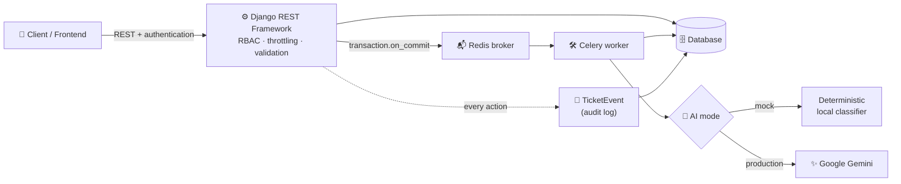
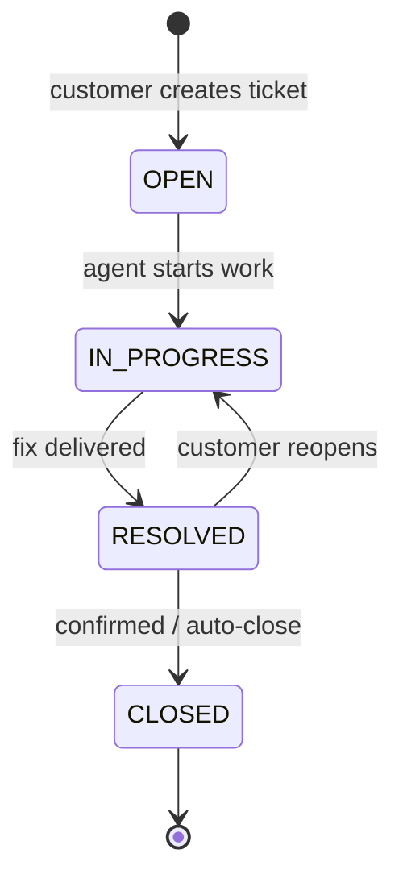
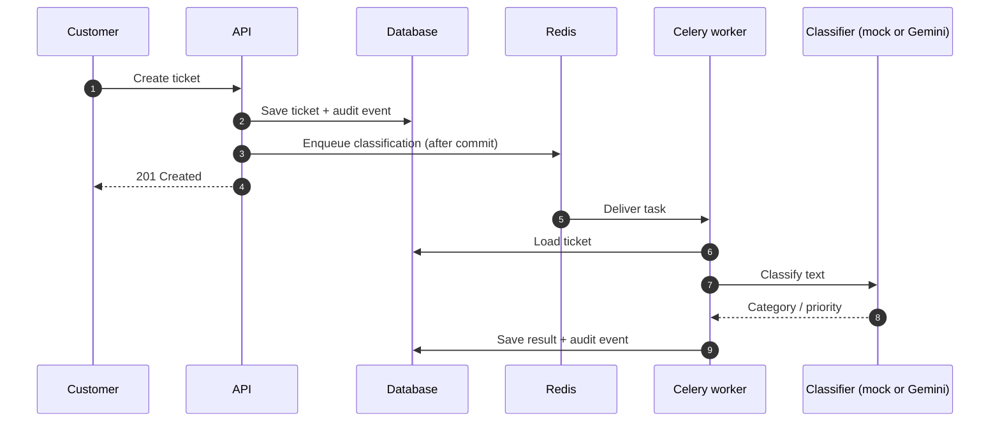
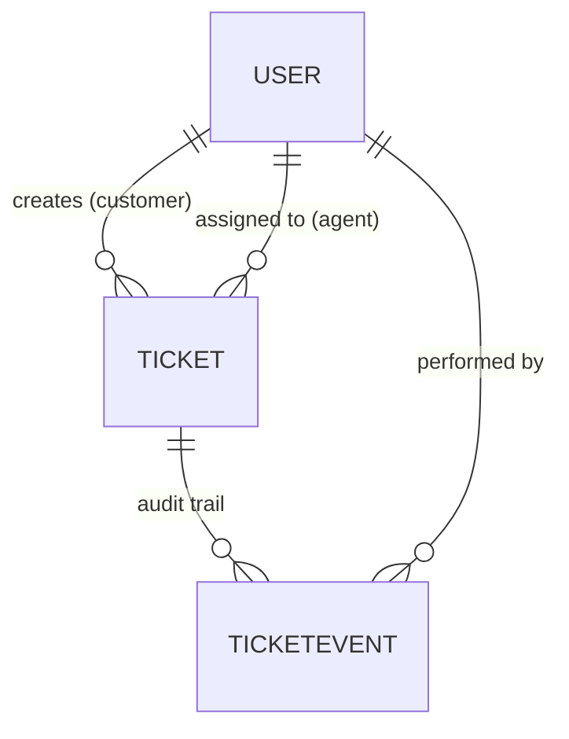

<div align="center">

# 🎫 Enterprise Intelligent Support Ticket System

### A Django backend that runs a real support workflow: role-based access, a controlled ticket lifecycle, SLA tracking, an immutable audit trail, and AI-assisted ticket classification in the background.


</div>

---

## 📑 Table of Contents

1. [What is this project?](#1--what-is-this-project)
2. [The problem it solves](#2--the-problem-it-solves)
3. [Features](#3--features)
4. [Who uses it and how](#4--who-uses-it-and-how)
5. [System architecture](#5-%EF%B8%8F-system-architecture)
6. [Roles and permissions](#6--roles-and-permissions)
7. [Ticket lifecycle (state machine)](#7--ticket-lifecycle-state-machine)
8. [Audit trail](#8--audit-trail)
9. [AI classification pipeline](#9--ai-classification-pipeline)
10. [Reliable background dispatch (`on_commit`)](#10--reliable-background-dispatch-on_commit)
11. [SLA monitoring](#11-%EF%B8%8F-sla-monitoring)
12. [Rate limiting](#12--rate-limiting)
13. [Data model](#13--data-model)
14. [API overview](#14--api-overview)
15. [Code structure](#15--code-structure)
16. [Technology choices and why](#16-%EF%B8%8F-technology-choices-and-why)
17. [Getting started](#17--getting-started)
18. [Configuration reference](#18-%EF%B8%8F-configuration-reference)
19. [Testing](#19--testing)
20. [Troubleshooting](#20--troubleshooting)
21. [Security notes](#21-%EF%B8%8F-security-notes)
22. [Limitations](#22-%EF%B8%8F-limitations)
23. [Roadmap](#23-%EF%B8%8F-roadmap)
24. [Author](#24--author)

> **Note on accuracy:** sections marked **🔎 Verify** follow from the project's design, but exact names (statuses, roles' permissions, endpoint paths, SLA numbers) should be checked against the code before publishing. The generated Swagger docs and `schema.yml` are the source of truth for the API.

---

## 1. 🎯 What is this project?

**Enterprise Intelligent Support Ticket System** is a backend service for handling customer support requests the way a real support organization does.

Customers raise tickets. Each ticket is automatically classified in the background, assigned to the right people, moved through a controlled lifecycle, tracked against service-level deadlines (SLAs), and recorded in an audit log so that every change can be explained later.

It is a **modular Django monolith** built with Django 5 and Django REST Framework, with Celery and Redis for background work.

---

## 2. 🧩 The problem it solves

| Pain point in support teams | How this project addresses it |
|---|---|
| Manual triage wastes time | Tickets are classified automatically by an AI step running in the background |
| Unclear ownership | Dedicated roles (customer, agent, manager, admin) with assignment |
| Tickets jumping to impossible states | A state machine allows only valid status transitions |
| Missed deadlines | Configurable SLA tracking highlights at-risk and breached tickets |
| "Who changed this and when?" | An immutable audit event is written for every action |
| Slow responses when AI is slow or down | AI runs asynchronously; ticket creation never depends on it |
| Abuse of the API | Rate-limited endpoints |

---

## 3. ✨ Features

### Identity and access
- **Custom email-based user model** (login with email instead of username)
- **Four roles:** `ADMIN`, `MANAGER`, `AGENT`, `CUSTOMER`
- **Server-side RBAC** enforced with DRF permission classes (the client is never trusted for authorization)

### Ticket workflow
- **State-machine status transitions** so only valid changes are accepted
- **Immutable audit log** (`TicketEvent`) recorded on every action

### Automation
- **Asynchronous AI classification** via Celery + Redis
- **Dual-mode AI engine:**
  - **Mock mode:** deterministic, runs locally with **no API key**
  - **Production mode:** Google **Gemini**
- **Safe task dispatch** using `transaction.on_commit`, which prevents the "task runs before the data exists" race

### Operations
- **Configurable SLA monitoring**
- **Throttled (rate-limited) endpoints**
- **Interactive OpenAPI 3.0 docs** (Swagger) through `drf-spectacular`, plus a committed `schema.yml`
- **Docker and Docker Compose** support
- **pytest** test suite

---

## 4. 🧭 Who uses it and how

| Person | Typical journey |
|---|---|
| **Customer** | Signs in, opens a ticket describing a problem, tracks its status, replies when asked |
| **Agent** | Sees tickets assigned to them, works them, moves them through the allowed statuses |
| **Manager** | Oversees the team, assigns or reassigns tickets, watches SLA risk |
| **Admin** | Manages users and system configuration, has full visibility |

**A ticket's life in short:**

1. A customer creates a ticket → the API responds immediately.
2. A background task classifies it (for example by category and priority).
3. A manager or the system assigns it to an agent.
4. The agent works it through the lifecycle until it is resolved and closed.
5. SLA timers track whether it is on time; every step is written to the audit log.

---

## 5. 🏗️ System architecture



### Request path vs. background path

| | Request path (synchronous) | Background path (asynchronous) |
|---|---|---|
| **Runs in** | Django web process | Celery worker |
| **Does** | Validate, authorize, save ticket, write audit event, enqueue task | Classify ticket, update fields, record result |
| **Latency goal** | Fast, predictable | Can be slower; not user-blocking |
| **If it fails** | User gets an error immediately | Ticket still exists; classification can be retried |

---

## 6. 👥 Roles and permissions

Roles are stored on a custom user model and enforced by DRF permission classes on the server.

| Role | Intended capabilities |
|---|---|
| **CUSTOMER** | Create tickets; view and comment on **their own** tickets |
| **AGENT** | View and work **assigned** tickets; change status within allowed transitions |
| **MANAGER** | Everything an agent can do, plus assign/reassign tickets and view team-wide tickets and SLA status |
| **ADMIN** | Full access, including user management and configuration |

> 🔎 **Verify:** this matrix reflects the intended design. Replace it with the exact permissions implemented in your permission classes, for example a table with one row per action (create, view own, view all, assign, change status, close, view audit log) and a ✅/❌ per role.

**Why server-side?** Hiding a button in the UI is not security. Every endpoint checks the caller's role and ownership before acting, so a crafted request from a customer cannot perform an agent or manager action.

---

## 7. 🔁 Ticket lifecycle (state machine)

A ticket cannot jump to an arbitrary status. Each status has a defined set of valid next statuses, and any other change is rejected.



> 🔎 **Verify:** replace the status names and arrows with the real values from your ticket model (for example `NEW`, `ASSIGNED`, `PENDING_CUSTOMER`, `ESCALATED`) and note which role may trigger each transition.

**Benefits of a state machine**

- invalid data states are impossible,
- the workflow is easy to reason about and test,
- every transition can be audited.

---

## 8. 🧾 Audit trail

Every action on a ticket writes an **immutable `TicketEvent`**.

| Captured | Why |
|---|---|
| **Who** performed the action | Accountability |
| **What** happened (created, assigned, status changed, classified, commented) | Reconstruct history |
| **When** it happened | Timeline and SLA analysis |
| **Before / after details** where relevant | Understand what changed |

Because events are append-only, you can answer questions such as *"who moved this ticket to RESOLVED?"* or *"when was it reassigned and by whom?"* long after the fact.

> 🔎 **Verify:** list the exact event types your system records.

---

## 9. 🤖 AI classification pipeline

After a ticket is created, a **Celery task** analyses its text and fills in classification fields (for example category and priority).



### Two modes

| Mode | Behaviour | API key needed |
|---|---|---|
| **Mock** | Deterministic, rule-based classification for development, tests, and demos | ❌ No |
| **Gemini** | Uses Google Gemini for production-style classification | ✅ Yes |

### Why asynchronous?

- Creating a ticket stays fast even if the AI is slow.
- If the AI provider is down or rate-limited, **tickets are still created**, and classification can be retried.
- The mock mode makes the whole system runnable and testable offline.

> 🔎 **Verify:** state which fields the classifier sets, the retry policy (if any), and what happens when classification fails.

---

## 10. 🧵 Reliable background dispatch (`on_commit`)

A subtle bug in many Django + Celery apps:

```text
1. Code saves a ticket inside a database transaction
2. Code enqueues a Celery task immediately
3. The worker starts BEFORE the transaction commits
4. Worker looks up the ticket → "does not exist"   ❌
```

This project enqueues tasks with **`transaction.on_commit`**, so the task is only sent **after** the ticket is durably saved:

```python
from django.db import transaction

# Illustrative: the task is dispatched only after the commit succeeds
transaction.on_commit(lambda: classify_ticket.delay(ticket.id))
```

If the transaction rolls back, the task is never sent, so no orphaned jobs exist for tickets that were never saved.

> 🔎 **Verify:** replace the snippet with your real call site, or keep it as an illustration.

---

## 11. ⏱️ SLA monitoring

An **SLA (Service Level Agreement)** is the promised time to respond to and resolve a ticket. Targets are **configurable**.

| Concept | Meaning |
|---|---|
| **Target** | Time allowed (often depends on priority) |
| **On track** | Within target |
| **At risk** | Approaching the target |
| **Breached** | Target time exceeded |

Managers use SLA status to decide which tickets need attention first.

> 🔎 **Verify:** document your real rules here, for example:
>
> | Priority | First response | Resolution |
> |---|---|---|
> | Critical | … | … |
> | High | … | … |
> | Normal | … | … |
> | Low | … | … |
>
> and how breaches are detected (calculated on read, or by a scheduled task).

---

## 12. 🚦 Rate limiting

Endpoints are throttled with DRF's throttling classes to protect the service from abuse and accidental request floods. When a client exceeds its limit, the API responds with `429 Too Many Requests`.

> 🔎 **Verify:** state the configured limits (for example per-user and anonymous rates).

---

## 13. 🗄️ Data model



| Model | Purpose |
|---|---|
| `User` | Custom email-based user with a role (`ADMIN`, `MANAGER`, `AGENT`, `CUSTOMER`) |
| `Ticket` | The support request: subject, description, status, priority, category, assignee, timestamps |
| `TicketEvent` | Immutable audit record of every action on a ticket |

> 🔎 **Verify:** add real field lists from `apps/*/models.py`, plus any extra models (comments, teams, SLA configuration).

---

## 14. 📡 API overview

The authoritative reference is the interactive Swagger UI generated by `drf-spectacular`, and the committed `schema.yml`.

- Swagger UI (local): `http://localhost:8000/api/docs/` *(check the exact path in `config/urls.py`)*
- Raw schema: [`schema.yml`](schema.yml)

Typical endpoint groups:

| Area | Purpose |
|---|---|
| **Authentication** | Register, log in, obtain/refresh tokens |
| **Tickets** | Create, list (filtered by role), retrieve, update |
| **Assignment** | Assign or reassign a ticket (manager/admin) |
| **Status transitions** | Move a ticket through the lifecycle |
| **Audit events** | View the history of a ticket |
| **Users** | Admin user management |

> 🔎 **Verify:** replace this table with real routes, methods, and which role may call each.

---

## 15. 🧱 Code structure

```text
support-ticket-system/
├── apps/                 # Django apps (users, tickets, audit, ...)
├── config/               # Settings, URL routing, Celery configuration
├── frontend/             # Client UI
├── tests/                # pytest suite
├── schema.yml            # Generated OpenAPI schema
├── Dockerfile
├── docker-compose.yml
├── manage.py
├── pytest.ini
├── requirements.txt
└── .env.example
```

> 🔎 **Verify:** list the actual apps inside `apps/` with one line each (for example `users` – custom user and roles, `tickets` – tickets and lifecycle, `audit` – event log).

**Architectural style:** a **modular monolith**. Features live in separate Django apps with clear responsibilities but deploy as one service. This keeps development and debugging simple while preserving clean boundaries.

---

## 16. 🛠️ Technology choices and why

| Technology | Why |
|---|---|
| **Django 5 + DRF** | Mature ORM, migrations, authentication, permissions, and fast API development |
| **Custom email-based user model** | Email login is more natural for customers and avoids username management |
| **Celery + Redis** | Reliable background processing for AI classification |
| **Google Gemini + mock mode** | Real AI in production; deterministic offline mode for development and tests |
| **drf-spectacular** | Automatic OpenAPI 3 schema and Swagger UI |
| **pytest** | Concise, powerful tests |
| **Docker / Compose** | Reproducible environment |

---

## 17. 🚀 Getting started

### Prerequisites

| Requirement | Notes |
|---|---|
| Python 3.11+ | |
| Redis | Needed for Celery; easiest via Docker |
| Git | |
| Gemini API key | **Optional**: only for production AI mode |

### Step 1: Clone and install

```powershell
git clone https://github.com/ShashankSingh2020/support-ticket-system.git
cd support-ticket-system

python -m venv venv
.\venv\Scripts\Activate.ps1
pip install -r requirements.txt
```

> macOS/Linux: activate with `source venv/bin/activate`.

### Step 2: Configure the environment

```powershell
Copy-Item .env.example .env
```

Open `.env` and fill in the values listed in `.env.example`. **Keep the AI setting on mock mode** to run everything without an API key. Never commit `.env`.

### Step 3: Start Redis

```powershell
docker run -d --name redis -p 6379:6379 redis
```

(or use the provided `docker-compose.yml`).

### Step 4: Migrate and create an admin

```powershell
python manage.py migrate
python manage.py createsuperuser
```

### Step 5: Run the API and the worker (two terminals)

```powershell
# Terminal 1: Django API
python manage.py runserver 8000
```

```powershell
# Terminal 2: Celery worker  (-P solo is needed on Windows)
celery -A config worker --loglevel=info -P solo
```

### Step 6: Explore

- Open the Swagger UI and authenticate.
- Create a customer user, then create a ticket.
- Watch the worker terminal: the classification task runs shortly after the ticket is created.
- Fetch the ticket again to see the classification and the audit events.

### Run everything with Docker

```powershell
docker compose up --build
```

> 🔎 **Verify:** confirm what your `docker-compose.yml` starts (web, worker, Redis, database) and adjust this section.

---

## 18. ⚙️ Configuration reference

Copy `.env.example` to `.env`. Typical settings:

| Variable | Purpose |
|---|---|
| `DEBUG` | Django debug mode; **must be `False` in production** |
| `SECRET_KEY` | Django secret key |
| Database setting | Connection details for your database |
| Redis / Celery broker URL | Where Celery connects (for example `redis://127.0.0.1:6379/0`) |
| AI mode switch | Mock or Gemini |
| `GEMINI_API_KEY` | Only needed in Gemini mode |

> 🔎 **Verify:** replace this table with the exact variable names in `.env.example`.

---

## 19. 🧪 Testing

```powershell
pytest
```

Configuration is in `pytest.ini`.

Recommended coverage areas:

- **Permissions:** each role can and cannot do the right things,
- **State machine:** valid transitions succeed and invalid ones are rejected,
- **Audit log:** every action creates an event,
- **Async dispatch:** classification task is enqueued after commit,
- **Mock classifier:** deterministic output.

> 📏 *Add your real numbers when you have them, for example "N tests covering permissions, transitions, and auditing".*

---

## 20. 🩹 Troubleshooting

| Symptom | Likely cause | Fix |
|---|---|---|
| Tickets are created but never classified | Celery worker not running or Redis unreachable | Start Redis and the worker; check the broker URL |
| Celery crashes on Windows | Default pool not supported | Use `-P solo` |
| `403 Forbidden` on an action | Your role does not allow it | Use a user with the correct role |
| Invalid status change rejected | State machine blocks it | Check allowed transitions for the current status |
| `429 Too Many Requests` | Throttle limit reached | Wait and retry |
| Gemini errors | Missing or invalid key | Switch to mock mode or fix `GEMINI_API_KEY` |

---

## 21. 🛡️ Security notes

| Topic | Approach |
|---|---|
| Authorization | Server-side DRF permission classes; the client is never trusted |
| Auditability | Append-only `TicketEvent` records |
| Abuse protection | Throttled endpoints |
| Secrets | Environment variables only; `.env` is git-ignored |
| AI provider | In Gemini mode, ticket text is sent to Google's API; do not enable it for data that must not leave your environment |

---

## 22. ⚠️ Limitations

- Mock-mode classification is rule-based and meant for development, not for real accuracy.
- Not load-tested at scale.
- SLA behaviour depends on how breach detection is scheduled (see the SLA section).
- No email or push notifications yet.

---

## 23. 🗺️ Roadmap

- [ ] Notifications (email / in-app) for assignments and SLA risk
- [ ] Ticket comments and file attachments
- [ ] Manager analytics dashboard
- [ ] GitHub Actions CI
- [ ] Hosted demo
- [ ] Load testing and published results

---

## 24. 👤 Author

**Shashank Singh** — [GitHub](https://github.com/ShashankSingh2020)

If you found this project useful, consider giving it a ⭐.
