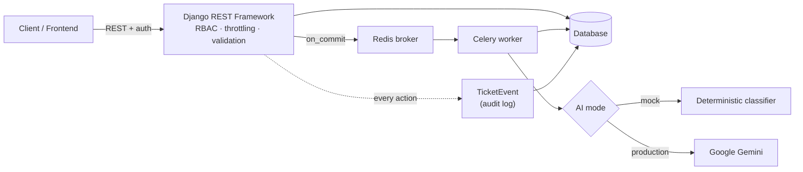
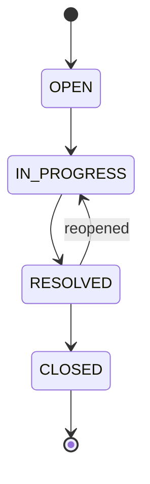

<div align="center">

# 🎫 Enterprise Intelligent Support Ticket System

**A Django backend for managing support tickets with role-based access, a controlled ticket lifecycle, configurable SLA monitoring, an immutable audit trail, and asynchronous AI classification.**


</div>

---

## 📑 Table of Contents

- [Overview](#-overview)
- [Key features](#-key-features)
- [Architecture](#%EF%B8%8F-architecture)
- [Roles and permissions](#-roles-and-permissions)
- [Ticket lifecycle](#-ticket-lifecycle)
- [AI classification](#-ai-classification)
- [SLA monitoring](#%EF%B8%8F-sla-monitoring)
- [Tech stack](#%EF%B8%8F-tech-stack)
- [Project structure](#-project-structure)
- [Getting started](#-getting-started)
- [API documentation](#-api-documentation)
- [Running tests](#-running-tests)
- [Design decisions](#-design-decisions)
- [Limitations](#%EF%B8%8F-limitations)
- [Roadmap](#%EF%B8%8F-roadmap)

---

## 🎯 Overview

Support teams lose time to manual triage, unclear ownership, and missed deadlines. This system models the real workflow instead of just exposing CRUD endpoints:

- customers raise tickets,
- tickets are classified in the background,
- agents and managers work them through a controlled lifecycle,
- SLA timers show what is at risk,
- every action leaves an audit record.

---

## ✨ Key features

- 🔐 **Custom email-based user model** with four roles: `ADMIN`, `MANAGER`, `AGENT`, `CUSTOMER`
- 🛡️ **Server-side RBAC** enforced with DRF permission classes (never trusted from the client)
- 🔁 **State-machine ticket transitions:** only valid status changes are accepted
- 🧾 **Immutable audit log** (`TicketEvent`) written on every action
- ⏱️ **Configurable SLA monitoring**
- 🤖 **Async AI classification** through Celery, with a deterministic **mock mode** (no API key) and a **Google Gemini** mode
- 🧵 **Safe task dispatch:** Celery tasks are enqueued with `transaction.on_commit`, so workers never run before the ticket exists in the database
- 🚦 **Rate-limited endpoints** (DRF throttling)
- 📚 **Interactive OpenAPI 3 docs** via `drf-spectacular`
- 🐳 **Dockerfile and docker-compose** included

---

## 🏗️ Architecture



**Request vs background work:** creating a ticket returns immediately. Classification runs in a worker and updates the ticket afterwards, so a slow or failing AI call never blocks or breaks ticket creation.

---

## 👥 Roles and permissions

| Role | Typical capabilities |
|---|---|
| **CUSTOMER** | Create tickets, view and comment on their own tickets |
| **AGENT** | Work assigned tickets, update status within allowed transitions |
| **MANAGER** | Assign and reassign tickets, view team tickets and SLA status |
| **ADMIN** | Full access, user and configuration management |

> Adjust this table to match the exact permission classes in `apps/`.

---

## 🔁 Ticket lifecycle

Status changes go through a state machine, so a ticket cannot jump to an arbitrary status.



> Replace the states above with the actual status values from your ticket model. Each transition writes a `TicketEvent` (who, what, when).

---

## 🤖 AI classification

After a ticket is created, a Celery task classifies it (for example category and priority) and stores the result.

| Mode | When to use | Needs API key |
|---|---|---|
| **Mock** | Local development, tests, demos | No |
| **Gemini** | Production-style runs | Yes |

If the AI step fails, the ticket is still created and usable; classification can be retried.

---

## ⏱️ SLA monitoring

SLA targets are configurable. Tickets are tracked against their targets so managers can see which are on time, at risk, or breached.

> Describe the exact rules here, for example: *response target by priority, resolution target by priority, how breaches are detected (scheduled task or on read).*

---

## 🛠️ Tech stack

| Layer | Technology |
|---|---|
| Framework | Django 5, Django REST Framework |
| Auth and RBAC | Custom email User model, DRF permissions |
| Async | Celery + Redis |
| AI | Google Gemini or built-in mock classifier |
| API docs | drf-spectacular (OpenAPI 3, Swagger UI) |
| Testing | pytest |
| Packaging | Docker, Docker Compose |

---

## 📂 Project structure

```text
support-ticket-system/
├── apps/              # Django apps (users, tickets, audit, ...)
├── config/            # Settings, URLs, Celery configuration
├── frontend/          # Client UI
├── tests/             # Test suite
├── schema.yml         # Generated OpenAPI schema
├── Dockerfile
├── docker-compose.yml
├── manage.py
├── pytest.ini
├── requirements.txt
└── .env.example
```

---

## 🚀 Getting started

### Prerequisites

- Python 3.11+
- Redis (or Docker Desktop to run it)
- A Gemini API key **only if** you want production AI mode

### 1. Clone and install

```powershell
git clone https://github.com/ShashankSingh2020/support-ticket-system.git
cd support-ticket-system

python -m venv venv
.\venv\Scripts\Activate.ps1
pip install -r requirements.txt
```

### 2. Configure environment

```powershell
Copy-Item .env.example .env
```

Open `.env` and fill in the values listed in `.env.example`. Leave the AI setting on mock mode to run without any API key. Never commit `.env`.

### 3. Migrate and create an admin

```powershell
python manage.py migrate
python manage.py createsuperuser
```

### 4. Run the services (separate terminals)

```powershell
# Terminal 1: API
python manage.py runserver 8000

# Terminal 2: Celery worker (-P solo is required on Windows)
celery -A config worker --loglevel=info -P solo
```

Redis must be running (for example `docker run -d -p 6379:6379 redis`, or use the provided `docker-compose.yml`).

### Run with Docker

```powershell
docker compose up --build
```

---

## 📚 API documentation

With the server running, open the interactive docs:

- Swagger UI: `http://localhost:8000/api/docs/`
- Raw schema: `schema.yml` in this repo

> Add a short table of your main endpoints here (create ticket, list tickets, assign, change status, view audit events).

---

## 🧪 Running tests

```powershell
pytest
```

Add your own numbers here once you have them, for example: *N tests covering permissions, state transitions, and audit logging.*

---

## 🧠 Design decisions

| Decision | Reason |
|---|---|
| State machine for status | Prevents invalid transitions and keeps the workflow auditable |
| Immutable `TicketEvent` log | Every change has an actor and a timestamp |
| `transaction.on_commit` for Celery dispatch | Avoids the race where a worker runs before the database commit |
| Mock AI mode | Development and CI work without keys or network calls |
| Server-side RBAC | Roles are never trusted from the client |
| Throttling | Protects endpoints from abuse |

---

## ⚠️ Limitations

- AI classification quality in mock mode is rule-based and only for development.
- SLA breach detection depends on how it is scheduled; see the SLA section.
- Not load-tested at scale. Add measurements here when you have them.

---

## 🗺️ Roadmap

- [ ] Email or in-app notifications for SLA risk
- [ ] Ticket comments and attachments
- [ ] Reporting dashboard for managers
- [ ] GitHub Actions CI
- [ ] Deployed demo

---

<div align="center">

Built by **[Shashank Singh](https://github.com/ShashankSingh2020)**

</div>
