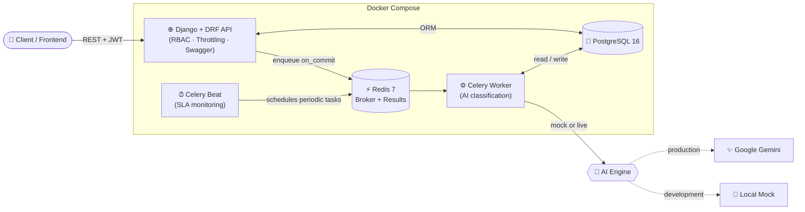
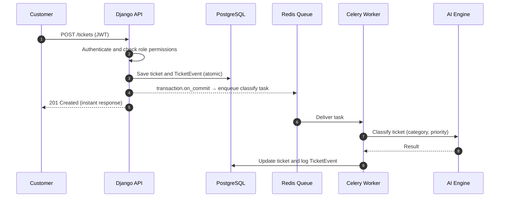

<div align="center">

# 🎫 Enterprise Intelligent Support Ticket System

**A production-style backend for managing customer support at scale, with AI-powered ticket classification, SLA monitoring, and role-based access control.**


[Overview](#-overview) •
[Features](#-key-features) •
[Architecture](#-architecture) •
[Tech Stack](#-tech-stack) •
[Quick Start](#-quick-start) •
[API Docs](#-api-documentation) •
[Testing](#-testing)

</div>

---

## 📖 Overview

Support teams drown in tickets: some are urgent, some are misrouted, and some quietly breach their deadlines. This project solves that with a **backend platform** that:

1. **Accepts tickets** from customers through a secure REST API.
2. **Classifies them automatically** (category and priority) using an AI engine running in the background, so the API stays fast.
3. **Routes work to the right people** using a strict role hierarchy: Admin, Manager, Agent, Customer.
4. **Tracks every change** in an immutable audit trail.
5. **Monitors SLAs** with scheduled background jobs so overdue tickets never go unnoticed.

> 💡 **Built to demonstrate real backend engineering:** layered architecture, async processing, security by design, containerisation, and automated testing.

---

## ✨ Key Features

| | Feature | What it does |
|---|---|---|
| 🔐 | **Role-Based Access Control** | Four roles (`ADMIN`, `MANAGER`, `AGENT`, `CUSTOMER`) enforced **server-side** through DRF permission classes. The UI is never trusted. |
| 👤 | **Custom Email-Based User Model** | Users authenticate with email instead of username, using JWT tokens (SimpleJWT). |
| 🔄 | **Ticket Workflow State Machine** | Status changes follow defined transitions, so invalid jumps are rejected. |
| 🧾 | **Immutable Audit Log** | Every action creates a `TicketEvent` record, giving a full, tamper-resistant history of who did what and when. |
| 🤖 | **Async AI Classification** | Celery workers classify tickets in the background, so API responses are never blocked by AI latency. |
| 🔁 | **Dual-Mode AI Engine** | A deterministic **mock mode** (no API key, ideal for dev and CI) and a **production mode** powered by **Google Gemini**. |
| ⏱️ | **Configurable SLA Monitoring** | Celery Beat runs periodic jobs that detect tickets at risk of, or already in, SLA breach. |
| 🛡️ | **Race-Condition Safe Tasks** | Tasks are dispatched via `transaction.on_commit`, so a worker never picks up a ticket that isn't committed to the database yet. |
| 🚦 | **Rate Limiting** | DRF throttling protects endpoints from abuse. |
| 📚 | **Interactive API Docs** | Auto-generated OpenAPI 3.0 / Swagger UI via `drf-spectacular`. |
| 🐳 | **One-Command Deployment** | Full stack (API, worker, scheduler, Postgres, Redis) runs with Docker Compose. |
| ✅ | **Automated Tests** | Pytest suite with `pytest-django`, `pytest-mock`, and coverage reporting. |

---

## 🏗️ Architecture

The project is a **modular Django monolith**: one deployable unit, with clean internal boundaries between domains. This gives the simplicity of a monolith with a structure that can be split into services later.



### 🔁 Request lifecycle: what happens when a ticket is created



> **Why `transaction.on_commit`?** If a task is queued *before* the database transaction commits, the worker may look for a ticket that doesn't exist yet. Dispatching on commit eliminates this race condition entirely.

---

## 🧰 Tech Stack

| Layer | Technology | Purpose |
|---|---|---|
| **Language** | Python | Core application language |
| **Framework** | Django 5.0, Django REST Framework 3.15 | Web framework and REST API |
| **Authentication** | `djangorestframework-simplejwt` | JWT access and refresh tokens |
| **Database** | PostgreSQL 16 (`psycopg2`) | Primary relational datastore |
| **Task Queue** | Celery 5.3 | Background jobs and scheduled tasks |
| **Broker / Cache** | Redis 7 | Message broker and result backend |
| **AI** | Google Gemini (plus local mock mode) | Ticket classification |
| **API Docs** | `drf-spectacular` | OpenAPI 3.0 schema and Swagger UI |
| **Filtering** | `django-filter` | Query filtering on list endpoints |
| **Validation** | Pydantic 2 | Structured validation of AI responses |
| **Config** | `django-environ`, `python-dotenv` | 12-factor environment configuration |
| **CORS** | `django-cors-headers` | Safe frontend–backend communication |
| **Testing** | Pytest, `pytest-django`, `pytest-mock`, Coverage | Automated testing and coverage |
| **DevOps** | Docker, Docker Compose | Containerised, reproducible environment |

---

## 📂 Project Structure

```text
support-ticket-system/
├── apps/                  # Modular Django apps (users, tickets, AI, SLA, ...)
├── config/                # Project settings, URLs, Celery configuration
├── frontend/              # Client-side interface
├── tests/                 # Automated test suite
├── Dockerfile             # API / worker image
├── docker-compose.yml     # Full stack: API, worker, beat, Postgres, Redis
├── manage.py              # Django entry point
├── pytest.ini             # Test configuration
├── requirements.txt       # Pinned dependencies
├── schema.yml             # Generated OpenAPI 3.0 schema
└── .env.example           # Environment variable template
```

---

## 🚀 Quick Start

### Option A: Docker (recommended, one command)

**Prerequisites:** Docker and Docker Compose.

```bash
# 1. Clone the repository
git clone https://github.com/ShashankSingh2020/support-ticket-system.git
cd support-ticket-system

# 2. Create your environment file
cp .env.example .env
# (Optional) add GEMINI_API_KEY to use the live AI engine

# 3. Start everything
docker compose up --build

# 4. In a new terminal: apply migrations and create an admin user
docker compose exec web python manage.py migrate
docker compose exec web python manage.py createsuperuser
```

**Services started:**

| Service | Container | Host Port |
|---|---|---|
| 🌐 Django API | `support_ticket_api` | `8000` |
| 🐘 PostgreSQL | `support_ticket_db` | `5433` |
| ⚡ Redis | `support_ticket_redis` | `6380` |
| ⚙️ Celery Worker | `support_ticket_worker` | n/a |
| ⏰ Celery Beat | `support_ticket_beat` | n/a |

### Option B: Local setup (PowerShell)

```powershell
# Create and activate a virtual environment
python -m venv venv
.\venv\Scripts\Activate.ps1

# Install dependencies
pip install -r requirements.txt

# Configure environment
Copy-Item .env.example .env

# Apply migrations and run the server
python manage.py migrate
python manage.py runserver
```

In separate terminals (with the venv activated), start the background processes:

```powershell
celery -A config worker --loglevel=info --pool=solo
celery -A config beat --loglevel=info
```

> 🪟 On Windows, Celery's `--pool=solo` flag avoids multiprocessing issues.

---

## 🤖 AI Classification Modes

The AI provider is switched with a single environment variable:

| Mode | `AI_PROVIDER` | API Key Needed | Best For |
|---|---|---|---|
| 🧪 **Mock** | `mock` | ❌ No | Local development, CI pipelines, demos, deterministic tests |
| ✨ **Gemini** | `gemini` | ✅ `GEMINI_API_KEY` | Production-grade classification |

The mock engine is deterministic, so tests never depend on network calls or API quotas. Responses are validated with **Pydantic**, so malformed AI output can't corrupt ticket data.

---

## 🔐 Roles and Permissions

Access control is enforced on the **server**, on every request.

| Role | Description |
|---|---|
| 👑 **ADMIN** | Full system control, including user and configuration management |
| 🧭 **MANAGER** | Oversees teams, monitors SLAs, and manages assignments |
| 🛠️ **AGENT** | Works on assigned tickets and updates their status |
| 🙋 **CUSTOMER** | Creates tickets and views only their own |

---

## 📚 API Documentation

Once the server is running, interactive documentation is generated automatically from the code:

- **Swagger UI:** `http://localhost:8000/` (see `config/urls.py` for the exact docs path)
- **OpenAPI schema:** [`schema.yml`](./schema.yml) in this repository

You can try every endpoint directly in the browser, authorising with a JWT token.

---

## 🧪 Testing

```bash
# Run the full test suite
pytest

# With coverage report
coverage run -m pytest
coverage report
```

The suite uses `pytest-django` for database-backed tests and `pytest-mock` to isolate external services such as the AI provider and Celery.

---

## ⚙️ Configuration

All configuration is environment-driven (see [`.env.example`](./.env.example)):

| Variable | Description |
|---|---|
| `DJANGO_SETTINGS_MODULE` | Settings module, e.g. `config.settings.development` |
| `DEBUG` | Enable or disable debug mode |
| `DATABASE_URL` | PostgreSQL connection string |
| `CELERY_BROKER_URL` | Redis URL for the Celery broker |
| `CELERY_RESULT_BACKEND` | Redis URL for task results |
| `AI_PROVIDER` | `mock` or `gemini` |
| `GEMINI_API_KEY` | Required only when `AI_PROVIDER=gemini` |

> ⚠️ **Never commit your `.env` file.** Use `.env.example` as the template.

---

## 🧠 Engineering Highlights

What this project demonstrates:

- **Separation of concerns:** modular apps with clear domain boundaries.
- **Async-first design:** slow AI work is moved off the request path with Celery and Redis.
- **Data integrity:** atomic transactions, `on_commit` task dispatch, and immutable audit events.
- **Security by design:** server-side RBAC, JWT authentication, and rate limiting.
- **Testability:** a deterministic mock AI mode and a mocked test layer.
- **DevOps readiness:** a fully containerised, reproducible multi-service environment.
- **API-first documentation:** a living OpenAPI spec generated from the code.

---

## 🗺️ Roadmap

- [ ] CI pipeline with GitHub Actions (tests and linting on every push)
- [ ] Email and webhook notifications on SLA breach
- [ ] Analytics dashboard for managers
- [ ] File attachments on tickets
- [ ] Production deployment configuration

---

## 👨‍💻 Author

**Shashank Singh**
B.Tech, Electronics and Communication Engineering, Bangalore Institute of Technology

[](https://github.com/ShashankSingh2020)

---

<div align="center">

⭐ If you found this project interesting, consider giving it a star!

</div>
